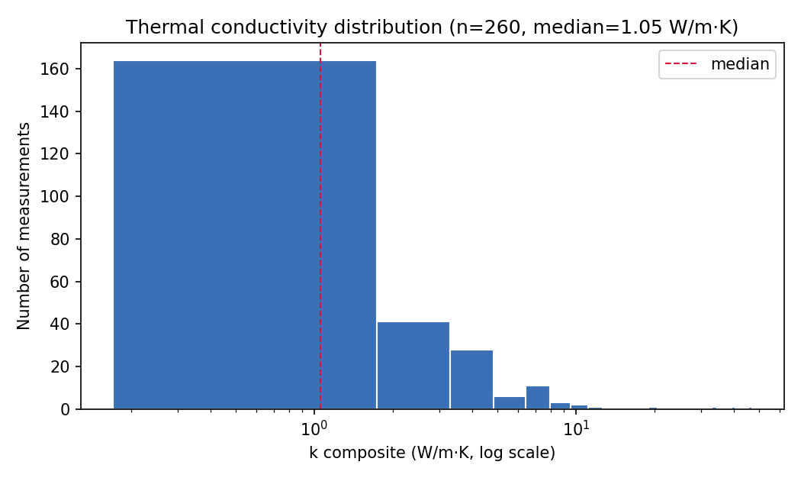
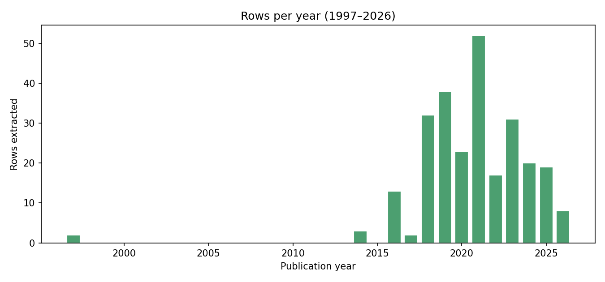
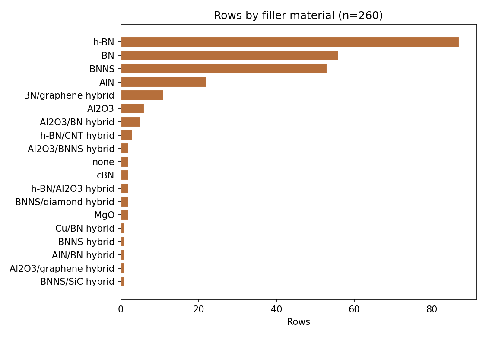
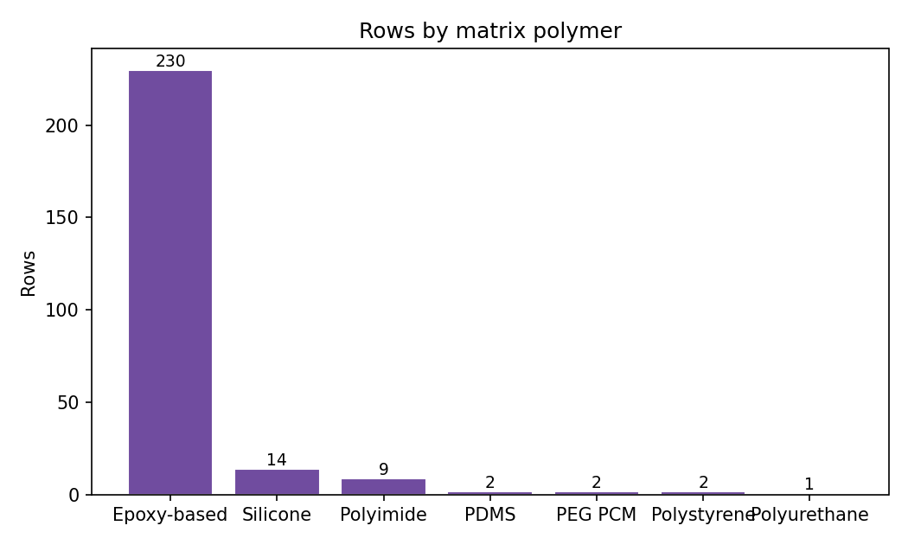
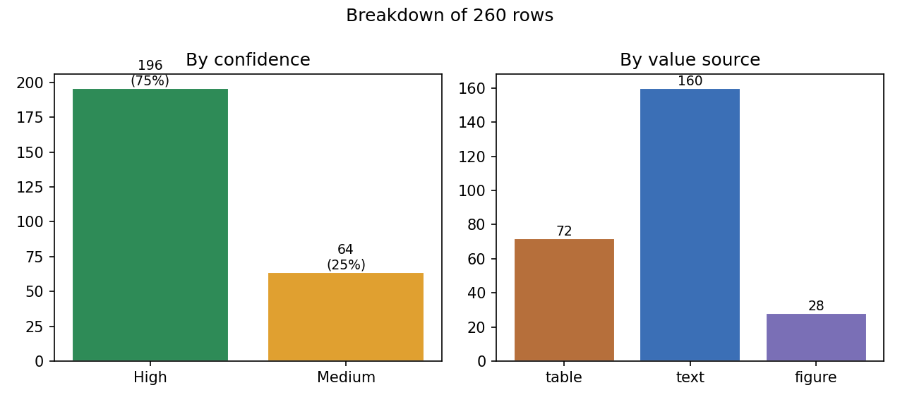
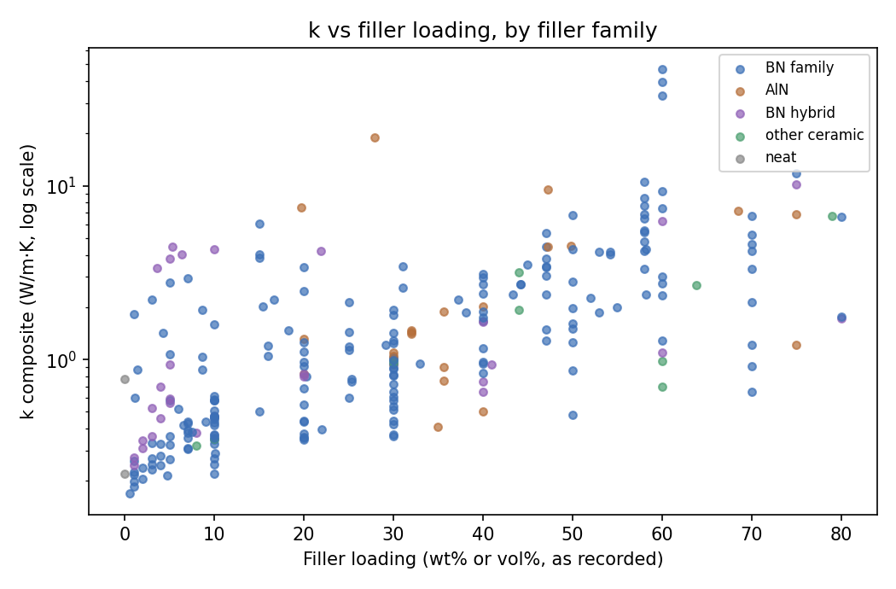

# FINAL REPORT — Source-Verified Thermal Conductivity Dataset for Polymer–Ceramic Composites

**Project:** ARGUS data-extraction pipeline · **Finalized:** 2026-10-18 · **Status:** Complete, presentation-ready
**Verification:** `work/final_verification.json` (14/14 checks PASS, incl. Phase 4) · **Dataset:** `thermal_conductivity_dataset.csv`

---

## 1. Project summary

This project built a **source-verified experimental dataset of effective thermal conductivity (k)** for polymer–ceramic composites, with primary focus on **epoxy matrices filled with h-BN / BNNS / AlN** — the leading filler systems for thermally conductive yet electrically insulating packaging and electronics materials. A four-stage pipeline (discovery → full-text retrieval → per-paper extraction → multi-phase QC audit) produced **260 measurement rows from 95 papers (1997–2026)**, each carrying a `source_location` trace back to the exact table, figure, or sentence it came from. The project enforces a **zero-hallucination policy**: every value is copied or unit-converted from a retrieved source, or pixel-digitized from a source figure by a reproducible script (flagged `value_source=figure`, Medium); no value is estimated, averaged, or inferred. Literature-comparison values quoted inside papers are excluded.

---

## 2. Key numbers

| Metric | Value |
|---|---|
| Measurement rows | **260** |
| Unique papers | **95** |
| Year range | **1997 – 2026** |
| k_composite range | **0.17 – 47.03 W/m·K** |
| Median k | **1.05 W/m·K** |
| Confidence | **196 High (75.4%) / 64 Medium (24.6%)** |
| Value source | 160 text / 72 table / 28 figure (pixel-digitized) |
| Epoxy-based rows | **230 (88.5%)** |
| BN-family rows (h-BN + BN + BNNS + cBN) | **198** |
| BN-containing rows incl. hybrids | 227 |
| Columns in full schema | 31 |
| Excluded/blocked sources logged | 49 |

Top fillers: h-BN (87), BN (56), BNNS (53), AlN (22), BN/graphene hybrid (11). Optional matrices (tagged): silicone (14), polyimide (9), PDMS (2), PEG PCM (2), polystyrene (2), polyurethane (1).

---

## 3. Methodology (4-step pipeline)

1. **Discovery** — Crossref + Semantic Scholar + Europe PMC API searches targeting polymer/epoxy/BN/BNNS/AlN + thermal conductivity; abstract triage for experimental composite k values (`work/discover*.py`, `work/screen.py`).
2. **Full-text retrieval** — Europe PMC fullTextXML (open access), ChemRxiv, unpaywall, OA repositories (Kobe, MRS-Journal, scichina). Publisher HTML blocked (403/captcha) for Wiley/Elsevier/Springer/IOP/ACS is logged in `unusable_sources.csv`. Phase 3 added Semantic Scholar abstract harvest for still-blocked papers (`work/phase3_fetch.py`, `work/phase3c_abstracts.py`).
3. **Per-paper extraction** — 27 hand-written, per-paper Python scripts (`work/extract_001.py` … `extract_027.py`) parse retrieved text/tables. Every row carries a verbatim `source_location` (quote or table ID), original k value + unit, normalized k in W/m·K, loading (wt%/vol%), filler, matrix, and provenance fields. `work/io_append.py::append_rows()` enforces schema and rejects non-numeric k or missing provenance.
4. **QC audit (Phases 1–4)** — Phase 1: row-level audit (154 findings classified); Phase 2: remediation (duplicates, loading corrections, title fixes); Phase 3: coverage expansion (+59 rows, +30 papers); Phase 4: browser-fetched full-text upgrades and reproducible figure digitization (+28 rows, +2 papers). Each phase has a machine-readable change record and a PASS verification JSON (see §4).

**Zero-hallucination policy:** values are only recorded when printed in the source (text or table) or pixel-digitized from a source figure by `work/phase4_digitize_v2.py` (calibrated on tick marks; overlays saved for review). Abstract-only rows are flagged `confidence=Medium` and prefixed `Abstract (...)` in `source_location`; figure rows are `value_source=figure`, `confidence=Medium`. Sci-Hub was deliberately not used (documented policy row in `unusable_sources.csv`).

---

## 4. Quality assurance

| Phase | Outcome | Evidence |
|---|---|---|
| Phase 1 audit | 154 findings classified (D1–D…, incl. duplicate-appends, non-numeric cells, title mismatches); verdict recorded | `audit_phase1_report.md`, `work/audit_phase1_results.json` |
| Phase 2 remediation | **15 duplicate/out-of-scope rows dropped**, 20 loading corrections (17 applied, 3 on dropped rows), 11 titles corrected, 9 non-numeric cells repaired, 7 label repairs. Dataset 188 → 173 rows. **22/22 verification checks PASS** | `work/phase2_applied_changes.json`, `work/phase2_verification.json` |
| Phase 3 expansion | **+59 rows / +30 papers** (local re-grep +13, repository fetches +14, abstract harvest +32). 173 → 232 rows, 63 → 93 papers; both stretch targets met (≥200 rows, ≥65 papers). Abstract-only rows flagged Medium | `work/phase3_changes.json`, `work/phase3_verification.json` |
| Phase 4 merge | **4 rows Medium→High** from OA full texts (AIP, SAGE, Springer); **12 year/title corrections** from publisher pages; 6 abstract values re-confirmed; **+28 figure-digitized rows / +2 papers** (polym11071156 Fig. 11, molecules21050670 Fig. 3). The earlier visual digitization listed points not present in the figure and was superseded. 232 → 260 rows | `work/phase4_changes.json`, `work/phase4_digitize_v2.py`, `work/figures/overlay_*.png` |
| Final verification | 14/14 checks PASS: JSONL↔CSV field-identical, 260 unique row_ids, no Phase-2 drop resurrection, all k numeric/positive, all rows have source_location + loading (+1 documented exception) + DOI, only High/Medium labels, uncertain CSV covers all 64 Medium rows, inventory = 95 papers, plus 5 Phase-4 checks (figure rows flagged and traceable, upgrades High with full-text quotes, new rows present, Ag hybrid excluded, unusable list updated) | `work/final_verification.json` |

Backups at every phase boundary: `work/backup_phase1/`, `work/backup_phase2/`, `work/backup_phase3/`, `work/backup_phase4/` (pre-Phase-4 state), `work/backup_final/`.

---

## 5. Figure gallery

**Figure 1.** k_composite distribution (n=260, log x-axis). Median 1.05 W/m·K; long right tail from highly loaded (≥60 wt%) BN/BNNS networks reaching 47.03 W/m·K.

**Figure 2.** Extracted rows per publication year, 1997–2026 — coverage is strongest in 2020–2025, matching the boom in BN/epoxy TIM research.

**Figure 3.** Rows by normalized filler material. h-BN (87), BN (56), BNNS (53), AlN (22) dominate; hybrid fillers (BN/graphene, Al₂O₃/BN, BN/CNT…) are retained and labeled.

**Figure 4.** Rows by matrix polymer: 230 epoxy-based (88%) plus optional matrices (silicone, PI, PDMS, PEG, PS, PU) for context.

**Figure 5.** Confidence (196 High / 64 Medium) and value source (160 text / 72 table / 28 figure). Medium = 28 abstract-only Phase-3C rows + 28 Phase-4 figure-digitized rows + 8 earlier partial-metadata rows.

**Figure 6.** k_composite vs filler loading (wt% or vol% as recorded), colored by filler family. Monotonic loading dependence with scatter from particle size, alignment, and processing differences.

---

## 6. Coverage & limitations

- **Publisher blocks:** ~200 candidate DOIs behind Wiley/Elsevier/Springer/IOP/ACS/SAGE 403s or captchas could not be fetched as full text (49 logged exclusions in `unusable_sources.csv`, incl. modeling/review/out-of-scope reasons). Recoverable in principle via browser automation or institutional access.
- **Abstract-only rows:** 28 Phase-3C rows are `confidence=Medium`, extracted from Semantic Scholar abstracts (4 others were upgraded from full text in Phase 4); matrix/curing/method metadata may be incomplete.
- **Figure-digitized values:** 28 rows (2 papers) were pixel-digitized; resolution ≈0.01–0.02 W/m·K per pixel and error bars are not captured. Exclude `value_source == 'figure'` if you only accept printed numbers.
- **Documented exception:** row `bf4f3fd7-182` (BN/PA66 scaffold) has no numeric loading — source states a sample designation only.
- **Anisotropy:** in-plane vs through-plane direction is recorded where reported (`k_direction`); mixed directions are pooled in aggregate statistics.
- **Units:** all k normalized to W/m·K with originals preserved; loadings mix wt% and vol% as reported — see `filler_loading_original_unit` before combining.

---

## 7. File inventory

| File | Purpose |
|---|---|
| `thermal_conductivity_dataset.csv` | Main dataset: 260 rows × 31 columns (utf-8-sig) |
| `paper_inventory.csv` | 95 papers: row counts, fillers, matrices, k ranges per paper |
| `extraction_log.csv` | 104-entry audit trail: what was inspected/rejected per batch |
| `uncertain_measurements.csv` | The 64 Medium-confidence rows for focused review |
| `unusable_sources.csv` | 49 excluded/blocked sources with explicit reasons |
| `quality_control_report.md` | Validation checks, stats, exclusions, recommendations |
| `README.md` | Dataset documentation, schema, scope, citation guidance |
| `FINAL_REPORT.md` | This presentation-ready summary |
| `figures/` | 6 final charts + `README.md` (generated from final data) |
| `audit_phase1_report.md` | Phase 1 audit findings |
| `work/final_verification.json` | Final 14-check verification (PASS) |
| `work/phase2_applied_changes.json`, `work/phase3_changes.json`, `work/phase4_changes.json` | Machine-readable change records |
| `work/phase2_verification.json`, `work/phase3_verification.json` | Phase PASS verifications |
| `work/backup_phase1/` … `backup_phase4/`, `backup_final/` | Reversibility backups |
| `work/extract_001.py` … `extract_027.py`, `phase4_apply.py`, `phase4_digitize_v2.py`, `io_append.py`, `build_deliverables.py` | Reproducible extraction/build pipeline |
| `work/fulltext/`, `work/phase4_browser/`, `work/figures/` | Retrieved source texts, publisher abstract pages, source figure images + digitization overlays |

---

## 8. How to reproduce

1. Source of truth is `work/rows_raw.jsonl` (260 rows). Deliverable CSVs are pure functions of it: run `python work/build_deliverables.py` from the project root (regenerates dataset, inventory, log, uncertain; the curated `unusable_sources.csv` is kept as-is).
2. Verify end state: `python work/final_verify.py` → regenerates `work/final_verification.json` and only rewrites CSVs if JSONL↔CSV mismatch is detected (with backup to `work/backup_final/`).
3. Regenerate figures: `python work/final_figures.py` → `figures/*.png`.
4. Phase histories are replayable from the change records + backups listed above; extraction scripts are per-paper and idempotent against the stored fulltexts in `work/fulltext/`. Phase 4: restore `work/backup_phase4/`, then run `python work/phase4_digitize_v2.py` and `python work/phase4_apply.py`.

---

## 9. Next steps

1. **More figure digitization:** the same script can recover further figure-only series (e.g. polym10030277; s10854 Fig. 3b at 10/20 wt%), plus the naked/open-marker series in molecules21050670 with a hollow-marker detector.
2. **Blocked-source recovery:** browser automation or institutional access for the ~200 blocked DOIs (largest single coverage lever).
3. **Abstract-only upgrades:** full-text retrieval for the 28 remaining abstract-only rows would convert them to High confidence.
4. **Pipeline hardening (Phase 2b):** open items D4/D7/D10 from the Phase-1 audit (normalize_k claim wording, one unverifiable k value, 3 silently dropped screened papers).

---

*All numbers in this report were verified against the final CSV/JSONL on 2026-10-18 (`work/final_verification.json`, OVERALL: PASS).*
