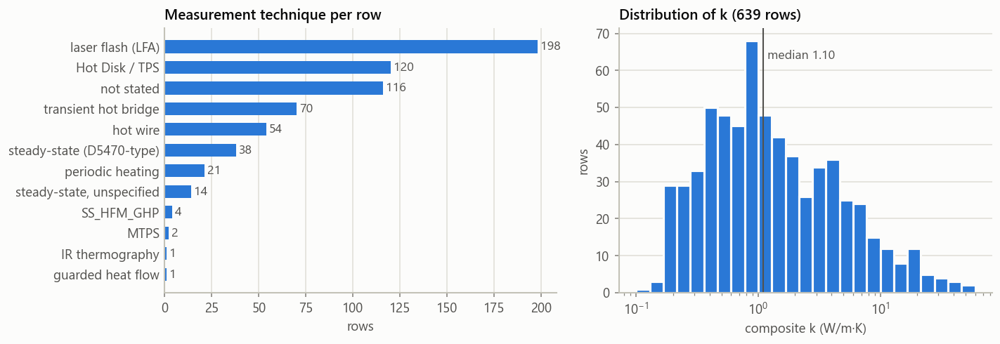
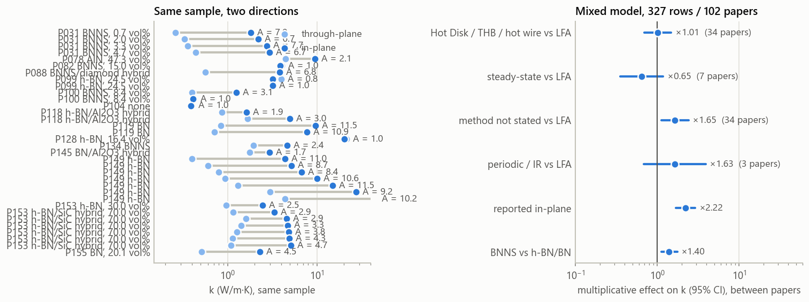
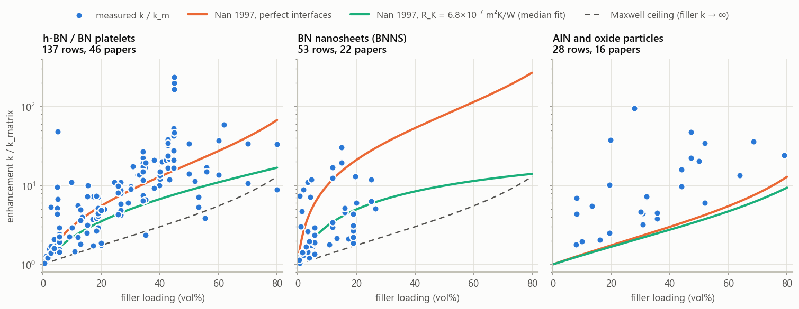
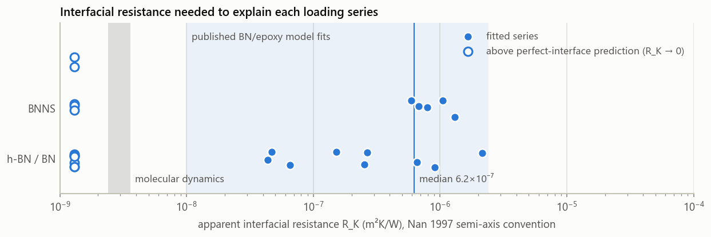
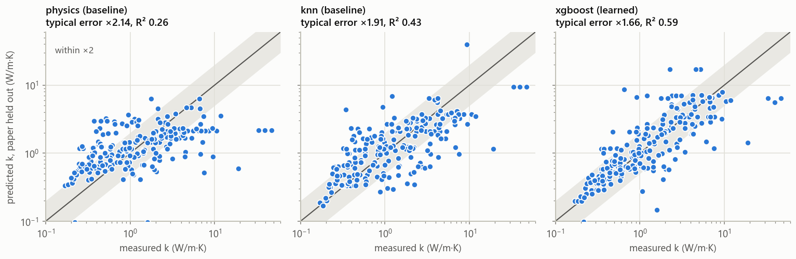
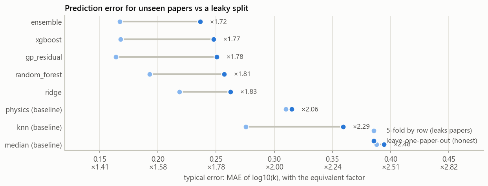
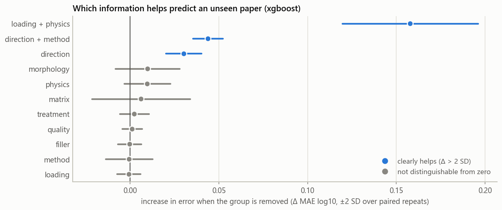
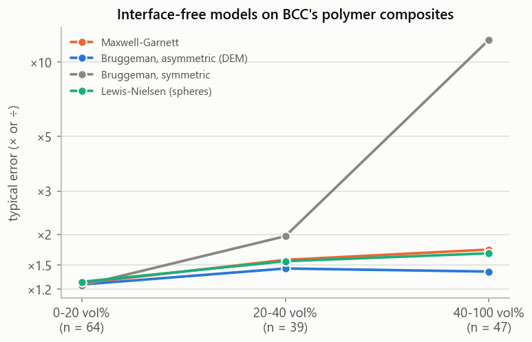
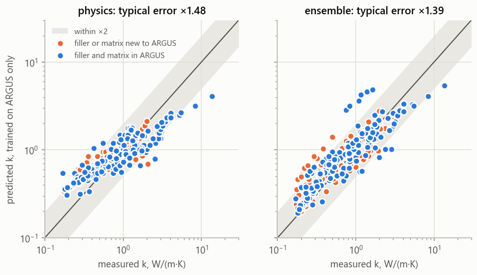

<!-- Generated by `argus report course` from data/records and reports/*.json. Do not edit by hand: edit the template (src/argus/report/templates/course_report.md.j2) and re-render. -->
# Thermal conductivity of BN- and AlN-filled polymers: what the measurement method does to the number

**Course:** Semiconductor Characterization Techniques · **Project:** ARGUS source-verified dataset, v1.2.0 (2026-10-25)
**Authors:** Aniket Kumar and Rao Kumar Srinidhi Reddy · **Repository:** `KumarSrinidhi/sctproject` · **Data fingerprint:** `893ecb8f094a61fb` · **Rendered:** 2026-10-26

## Abstract

Polymers, most often epoxies, filled with hexagonal boron nitride (h-BN), BN nanosheets (BNNS) or aluminium nitride (AlN) are used as thermal interface and encapsulation materials in semiconductor packages because they conduct heat while remaining electrical insulators. Their thermal conductivity *k* is reported in hundreds of papers, but it is measured with laser flash, transient plane-source, hot-bridge, hot-wire and steady-state methods that do not sense the same quantity. We built a source-verified dataset of **639 measurements from 174 open-access papers** (1997–2026), in which every value is traceable to a table, a sentence or a pixel-digitized figure, and used it to answer three characterization questions.

**How much does the method shift *k*?** Samples reported in both directions have a median in-plane/through-plane ratio of 4.07. An isotropic-mode transient sensor would therefore read up to 3.40× the laser-flash through-plane value on such a sample. Between papers, isotropic-mode sensors report 1.01× the *k* of laser flash at equal loading (95% CI 0.70–1.48). Paper-to-paper scatter (×1.87 at one standard deviation) far exceeds instrument uncertainty (about 8%).

**Do effective-medium models explain the data?** 97% of rows exceed the ceiling of any isolated-sphere (Maxwell) model, and the Nan 1997 platelet model needs an apparent interfacial resistance of 6.2×10⁻⁷ m²K/W (median), inside the range of published fits.

**Can *k* be predicted for a paper that was never seen?** With validation that holds out whole papers, an equal-weight ensemble of calibrated physics with a Gaussian-process correction, ridge regression and monotone gradient boosting reaches a typical error of ×1.72, against ×2.06 for calibrated physics, the best baseline. Splitting by row instead overstates accuracy. Tested on 274 measurements from 34 papers curated by others, the best model trained here (ensemble) reaches ×1.37 against ×1.45 for calibrated physics, a gap still within the uncertainty of 34 test papers. Our effective-medium code reproduces 6 of 7 published model columns of two independent implementations exactly (where the last one differs, the published values fail the model's own equation).

We close with a reporting checklist for *k* measurements on composite thermal interface materials, based on what the source papers most often left out.

---

## 1. Introduction

A semiconductor package removes heat from the die through a stack of layers: die attach, thermal interface material (TIM), lid or heat spreader, a second TIM and the heat sink. Each TIM contributes a thermal resistance per unit area

$$R_\mathrm{TIM} = \frac{\mathrm{BLT}}{k} + R_{c1} + R_{c2},$$
where BLT is the bond-line thickness and *R<sub>c</sub>* are the contact resistances to the neighbouring surfaces. Neat epoxy conducts poorly (*k* ≈ 0.2 W/m·K), so ceramic fillers are added. Hexagonal BN is attractive because it is a wide-bandgap electrical insulator with a very high in-plane conductivity: natural bulk h-BN measured by time-domain thermoreflectance gives 420 ± 46 W/m·K in-plane but only 4.8 ± 0.6 W/m·K through the plane [1]. AlN offers up to about 285 W/m·K in roughly isotropic grains [2].

The difficulty for anyone comparing these materials is characterization. The same composite can be reported as 1 W/m·K or 3 W/m·K depending on the instrument, the measurement direction and how density and heat capacity were obtained. A literature value is therefore only meaningful together with *how it was measured*. This project builds that context into the data.

**Contributions.**
1. **A source-verified dataset.** It covers 639 measurements from 174 papers, maintained as one reviewable record per paper with validation rules that block unverifiable values. A tested toolkit (`argus`) rebuilds every deliverable from those records.
2. **Characterization-aware labels.** Every row records the class of technique, the direction it most likely sensed, and flags for known biases.
3. **Three analyses:** method bias, physical models, and prediction for unseen papers, each validated against the data's own structure.
4. **A reporting checklist** derived from the gaps found in the literature.

## 2. How thermal conductivity is characterized

### 2.1 Four families of techniques

**Laser flash analysis (LFA)** measures thermal diffusivity *α* through a disc. A short pulse heats the front face, and an infrared detector records the rear-face temperature rise. In Parker's adiabatic solution the half-rise time *t*<sub>½</sub> gives

$$\alpha = \frac{1.38\,L^2}{\pi^2 t_{1/2}}, \qquad k = \alpha\,\rho\,c_p ,$$
with *L* the sample thickness [3]. Conductivity therefore depends on separately measured density *ρ* and specific heat *c<sub>p</sub>*, and their uncertainties stack up. A vendor quotes ±3% for *α* and ±5% for *c<sub>p</sub>* measured in the instrument [4], while careful DSC under ASTM E1269 reaches about 1.3–3.7% [5]. The governing standards are ASTM E1461 and ISO 22007-4. The scope of E1461 is "primarily homogeneous isotropic solid materials" [6], which a platelet-filled epoxy is not. On a standard disc holder LFA senses the **through-plane** direction.

**Transient plane-source and line-source probes** fit *k* and *α* from the heater's own temperature rise. This family includes the Hot Disk TPS (ISO 22007-2), the transient hot bridge (THB) and the hot wire or needle probe. For an ideal line source in an infinite isotropic medium,

$$\Delta T(t_2) - \Delta T(t_1) = \frac{q}{4\pi k}\,\ln\frac{t_2}{t_1}.$$
In an anisotropic plate a planar sensor in its **isotropic** mode reports approximately the geometric mean √(*k*<sub>in</sub> *k*<sub>through</sub>). Hot Disk states this for its isotropic module [7], and a depth-profiling study confirms it [8]. An anisotropic module separates the two directions, but only with an independently known *ρc<sub>p</sub>*.

**Steady-state one-dimensional rigs** impose a heat flux *q* across the specimen and measure the temperature drop, so that *q* = *k* Δ*T* / *L*. ASTM D5470 is the TIM standard because it measures the thermal impedance of the joint under controlled pressure. Plotting impedance against bond-line thickness separates the bulk *k* (from the slope) from contact resistance (the intercept). A single-thickness measurement returns an *apparent* *k* with contact resistance lumped in. These rigs are sensitive to alignment: misalignments as low as 1% often go undetected, and one stepped-bar rig reached ±6.4% at 95% confidence [9].

**Thin-film and microscale methods** (3ω, time- and frequency-domain thermoreflectance, lock-in thermography) are rarely applied to bulk filled-epoxy discs. Their relevance here is conceptual: low-frequency thermoreflectance with a small spot also senses a geometric mean, so direction mixing is a general property of transient methods with radial heat spreading [3].

### 2.2 Summary

| Technique | Primary quantity | Standard | Senses on a plate with in-plane platelets | Stated uncertainty |
|---|---|---|---|---|
| Laser flash, standard holder | *α*; *k* = *αρc<sub>p</sub>* | ASTM E1461, ISO 22007-4 | through-plane | *α* ±3%, *c<sub>p</sub>* ±5% (vendor) [4] |
| Hot Disk / TPS, isotropic mode | *k* and *α* | ISO 22007-2 | ≈ √(*k*<sub>in</sub>·*k*<sub>through</sub>) | ≤5% (facility listings) [7] |
| Hot Disk / TPS, anisotropic mode | *k*<sub>in</sub>, *k*<sub>through</sub> | ISO 22007-2 | both, given *ρc<sub>p</sub>* | — |
| Transient hot bridge, hot wire | *k* | ASTM D5930, ISO 8894 | mixed (radial flow) | 3–5% (vendor) |
| Steady-state heat flow (D5470) | thermal impedance | ASTM D5470 | through-plane, contact included | ±6.4% (95%) on a stepped bar [9] |
| 3ω, TDTR | *k*, interface conductance | — | local, cross-plane or mixed | <2% radiation error for 3ω [3] |

### 2.3 Why anisotropy turns method choice into a bias

Let *A* = *k*<sub>in</sub>/*k*<sub>through</sub>. If an isotropic-mode transient sensor reads √(*k*<sub>in</sub>*k*<sub>through</sub>), its ratio to a laser-flash through-plane value is

$$\frac{k_\mathrm{TPS}}{k_\mathrm{through}} = \sqrt{A}.$$
The literature supports the size of the effect, even if only through scattered evidence:
- In a five-method interlaboratory comparison on nominally isotropic PMMA, results agreed within about ±10%, but TPS read about 6% high [10].
- A polymer/BN compound patent reports Hot Disk 15–20% above LFA for isotropic fillers and up to 50% above for platelet fillers [11].
- On ten commercial filled TIMs, single-thickness D5470 values were "much higher" than TPS, more than double in one case. The authors attribute this to fillers bridging thin bond lines [12].

No peer-reviewed study was found that measured the same BN/epoxy specimen by LFA, TPS and D5470.

## 3. Data and methods

### 3.1 Scope and provenance

The dataset covers experimental effective *k* of polymer–ceramic composites. Epoxy is the primary matrix (271 of 639 rows), followed by silicone (119) and polyethylene (74). Another 12 matrix families and 77 rows of other polymers are retained and tagged. Fillers are h-BN (179 rows), BN of unspecified polytype (92), BNNS (116), AlN (44) and 141 rows with hybrid fillers.

Values come only from open-access full texts and abstracts. Every row carries:
- a `value_source` of text, table or figure;
- a verbatim `source_location`;
- a confidence of High or Medium.

The dataset follows a **zero-inference rule**: no value may be estimated, back-calculated or model-predicted. Values only available in figures were pixel-digitized with a tick-calibrated script and kept at Medium confidence. Abstract-only values are also Medium. The split is 552 High and 87 Medium rows, and 442 text, 169 table and 28 figure values.

Each paper is one YAML record. A validator with 21 rules blocks a build on any error: missing provenance, unit inconsistencies, figure values marked High, duplicate measurements, or reuse of a removed row id. Version 1.1 closed open items from an earlier audit:
- **Removed:** a back-calculated value and a model-predicted value.
- **Corrected:** eleven rows whose wt% held a sample designation rather than a mass fraction.
- **Relabelled:** four hybrid fillers.

Version 1.2 added 381 rows from 79 papers found by logged literature searches (OpenAlex) and read from Europe PMC full texts. One extractor took values printed in text or tables, and a second, independent one checked every row against the source; the import then re-checked every quote verbatim.

Every change since v1.0 is declared in a curation log and checked automatically.

### 3.2 Characterization labels

Free-text method descriptions were mapped to technique classes by ordered rules. A named technique wins over an instrument model, and when several are named the first one mentioned wins. "TC-3000", for example, is a laser flash when made by Sinku-Riko but a transient hot wire when made by Xi'an Xiaxi. The classes are:
- laser flash: 198 rows;
- Hot Disk/TPS: 120;
- transient hot bridge: 70;
- hot wire: 54;
- D5470-type steady state: 38;
- periodic heating: 21;
- steady state, apparatus not named: 14;
- 4 rarer classes (heat flow meter or guarded hot plate, modified transient plane source, guarded heat flow meter, IR thermography): 8 together;
- not stated: 116.

Each row also receives an *effective direction*: the reported one where available, otherwise a default implied by the method. Isotropic-mode transient sensors on BN platelets are labelled `mixed`. Bias flags mark mixed-direction readings, contact-included steady-state values and laser-flash rows that do not say how *c<sub>p</sub>* and *ρ* were obtained.

Loadings given as wt% were converted to vol% with reference densities. As a self-check, the 49 rows that report both bases agree with the conversion to within 4.62 vol% (median 1.66). This check found the designation-as-wt% defect corrected in v1.1.

### 3.3 Analyses

**Method bias.** Two kinds of evidence are used:
- **Same-sample pairs:** rows identical in paper, composition, processing and loading but reported in two directions or by two techniques.
- **A between-paper model:** a linear mixed model for BN-platelet composites,

$$\log_{10}\frac{k}{k_m} = \beta_0 + \beta_1\phi + \beta_2\phi^2 + \beta_\mathrm{BNNS} + \beta_\mathrm{in\text{-}plane} + \sum_g \beta_g\,[\mathrm{method}=g] + u_\mathrm{paper} + \varepsilon,$$
with a random intercept per paper, fitted by REML. Method is constant within most papers, so its effect is tested against the number of papers rather than rows.

**Physical models.** The core is Nan et al. (1997) for spheroids with an orientation average and interfacial (Kapitza) resistance *R<sub>K</sub>* [13]. It reduces exactly to Maxwell–Garnett for spheres without interface resistance and to Hasselman–Johnson with it. The project's tests enforce both limits. Lewis–Nielsen and Agari–Uno are fitted for comparison, with one free parameter per model fitted to each loading series on log *k*.

**Prediction.** 26 features were built row by row: loading, a physics estimate, filler, morphology, treatment, direction, method, matrix and data quality. Publication year is deliberately not a feature: inside ARGUS it carried no clear information, and on other groups' older papers it made the models extrapolate badly (Section 4.5). Models were scored by **leave-one-paper-out** cross-validation, so no paper ever appears on both sides of a split. Hyperparameters were tuned with an inner split that also holds out whole papers. Row-level random splits are reported only to show how much they leak.

## 4. Results

### 4.1 The dataset



*Figure 1. Left: rows per technique class. Right: distribution of composite* k *(639 rows; median 1.10 W/m·K, range 0.12–50.0).*

Laser flash and Hot Disk/TPS are the most common techniques. 18% of rows (116) come from papers that do not name the technique in the available text.

### 4.2 What the measurement method does to *k*



*Figure 2. Left: samples reported in both directions, with A = k<sub>in</sub>/k<sub>through</sub>. Right: multiplicative effects on* k *from the mixed model, with 95% intervals; laser flash is the reference.*

**Same-sample evidence.** 34 samples from 15 papers were reported both in-plane and through-plane:
- Samples without a three-dimensional network (films, sheets, platelet composites) show *A* = 0.80–11.50.
- Three-dimensional networks show *A* = 0.96–2.13. *A* below 1 is a network built to conduct vertically.

Through √*A*, an isotropic transient sensor would read 0.89–3.40× the through-plane value on these samples (×2.02 at the median). Even the median is larger than the patent's "up to 50%" for platelet fillers. **No sample in the dataset was measured with two different techniques** (0 pairs), so the direct effect of the instrument cannot be isolated from this literature.

| Paper | Filler | Structure | k in-plane (W/m·K) | k through-plane (W/m·K) | A |
|---|---|---|---|---|---|
| P031 | BNNS | nanosheet | 1.83 | 0.26 | 7.04 |
| P031 | BNNS | nanosheet | 2.22 | 0.33 | 6.73 |
| P031 | BNNS | nanosheet | 2.76 | 0.36 | 7.67 |
| P031 | BNNS | nanosheet | 2.95 | 0.44 | 6.70 |
| P078 | AlN | honeycomb network | 9.48 | 4.45 | 2.13 |
| P082 | BNNS | nanosheet network | 3.87 | 4.02 | 0.96 |
| P088 | BNNS/diamond hybrid | hybrid | 3.824 | 0.56 | 6.83 |
| P099 | h-BN | spherical assemblies of h-BN sheets | 3.2 | 4.0 | 0.80 |
| P099 | h-BN | spherical assemblies of h-BN sheets | 3.2 | 3.2 | 1.00 |
| P100 | BNNS | nanosheets / platelets | 1.26 | 0.4 | 3.15 |
| P100 | BNNS | nanosheets / platelets | 0.41 | 0.42 | 0.98 |
| P104 | none |  | 0.39 | 0.4 | 0.97 |
| P118 | h-BN/Al2O3 hybrid | h-BN platelets; Al2O3 spherical | 1.62 | 0.86 | 1.88 |
| P118 | h-BN/Al2O3 hybrid | h-BN platelets (3 mm × 3 mm square patterns, 130 μm thick); Al2O3 spherical | 4.99 | 1.68 | 2.97 |
| P119 | BN |  | 9.68 | 0.84 | 11.50 |
| P119 | BN |  | 7.72 | 0.71 | 10.90 |
| P128 | h-BN | platelet | 20.3 | 21.3 | 0.95 |
| P134 | BNNS | nanosheet | 4.65 | 1.94 | 2.40 |
| P145 | BN/Al2O3 hybrid | BN: two-dimensional flaky/planar; Al2O3: spherical | 2.95 | 1.78 | 1.66 |
| P149 | h-BN | platelet | 4.4 | 0.4 | 11.00 |
| P149 | h-BN | platelet | 5.2 | 0.6 | 8.67 |
| P149 | h-BN | platelet | 6.7 | 0.8 | 8.38 |
| P149 | h-BN | platelet | 10.0 | 0.94 | 10.60 |
| P149 | h-BN | platelet | 15.0 | 1.3 | 11.50 |
| P149 | h-BN | platelet | 27.5 | 3.0 | 9.17 |
| P149 | h-BN | platelet | 45.0 | 4.4 | 10.20 |
| P153 | h-BN | platelet (flakes, lateral size ~5–10 μm by SEM) | 2.45 | 0.96 | 2.55 |
| P153 | h-BN/SiC hybrid | h-BN platelets with SiC nanoparticles (quasi-spherical) anchored on surface/edges | 3.32 | 1.16 | 2.86 |
| P153 | h-BN/SiC hybrid | h-BN platelets with SiC nanoparticles (quasi-spherical) anchored on surface/edges | 4.59 | 1.61 | 2.85 |
| P153 | h-BN/SiC hybrid | h-BN platelets with SiC nanoparticles (quasi-spherical) anchored on surface/edges | 4.72 | 1.42 | 3.32 |
| P153 | h-BN/SiC hybrid | h-BN platelets with SiC nanoparticles (quasi-spherical) anchored on surface/edges | 4.85 | 1.27 | 3.82 |
| P153 | h-BN/SiC hybrid | h-BN platelets with SiC nanoparticles (quasi-spherical) anchored on surface/edges | 4.93 | 1.14 | 4.32 |
| P153 | h-BN/SiC hybrid | h-BN platelets with SiC nanoparticles (quasi-spherical) anchored on surface/edges | 5.12 | 1.09 | 4.70 |
| P155 | BN | sheets (mixture of BNNS and BN thick sheets after ball milling) | 2.31 | 0.512 | 4.51 |

**Between papers.** The mixed model was fitted to 327 rows from 102 papers.

| Effect (vs laser flash, h-BN/BN, not in-plane) | Factor on *k* | 95% CI | Papers |
|---|---|---|---|
| Isotropic-mode transient sensors (TPS, THB, hot wire) | 1.01 | 0.70–1.48 | 34 |
| Steady-state heat flow | 0.65 | 0.35–1.18 | 7 |
| Method not stated | 1.65 | 1.12–2.42 | 34 |
| Reported in-plane | 2.22 | 1.69–2.92 | — |
| BNNS vs h-BN/BN | 1.40 | 1.12–1.76 | — |

**Between papers, isotropic-mode sensors are indistinguishable from laser flash** (factor ×1.01, interval 0.70–1.48 over 34 papers). Whatever direction mixing does to a single anisotropic sample, it is lost in the paper-to-paper scatter: the instrument does not predict *k* once filler and loading are known. The estimate is stable across sensitivity fits:
- excluding abstract-only and figure rows: 1.06 (95% CI 0.72–1.56);
- only papers that report the neat-matrix *k*: 0.92 (95% CI 0.61–1.38).

The in-plane effect (×2.22, 95% CI 1.69–2.92) is clear and well determined.

Rows whose available text names no technique read ×1.65 the laser-flash value (95% CI 1.12–2.42; 34 papers), but the difference is not clear once abstract-only and figure rows are excluded (×1.43, 95% CI 0.93–2.20). Abstracts tend to quote a paper's best result, and they rarely name the instrument.

The model attributes 65% of the residual variance to differences between papers (intraclass correlation). One standard deviation between papers is a factor of 1.87. The judgement-based instrument uncertainty is about 8% per row, and pixel digitization adds a median of only 0.6%. **Sample preparation, filler grade and orientation dominate the spread, not instrument precision.**

### 4.3 What physical models can and cannot explain



*Figure 3. Enhancement* k/k<sub>m</sub> *against loading, by filler family, with the Maxwell ceiling (filler* k *→ ∞) and Nan 1997 for randomly oriented fillers, with perfect interfaces and with the median fitted R<sub>K</sub>. Model curves assume k<sub>m</sub> = 0.2 W/m·K, 10 µm fillers and t/D = 0.05 (h-BN), 0.01 (BNNS) or spheres (AlN). For AlN spheres the perfect-interface curve lies on the Maxwell ceiling, because the filler is about 1,400 times more conductive than the matrix.*

**The sphere ceiling.** For isolated spheres, even infinitely conductive ones, Maxwell–Garnett cannot exceed *k*/*k<sub>m</sub>* = (1 + 2*φ*)/(1 − *φ*). **396 of 410 rows with a known loading (97%) lie above that ceiling**. The Maxwell fit hit its parameter bound in all 26 loading series. Plate-like fillers, contact networks and alignment are therefore essential to these composites, not refinements.

**Platelets with interfacial resistance.** The Nan model for random h-BN platelets brackets most data between its perfect-interface and finite-*R<sub>K</sub>* curves. Fitting one *R<sub>K</sub>* per series gives a median of 6.2×10⁻⁷ m²K/W (interquartile range 1.3×10⁻⁷–9.4×10⁻⁷; semi-axis convention). That is inside the 10⁻⁸–2.4×10⁻⁶ range of published BN/epoxy fits [14, 15], and two to three orders of magnitude above molecular-dynamics values for ideal interfaces. The fitted resistance is therefore an *apparent* quantity that also absorbs voids, poor dispersion and filler–filler contacts. In 13 of 26 series the data exceed even the perfect-interface prediction, which points to alignment or percolating networks. Lewis–Nielsen, with *k<sub>f</sub>* fixed at the intrinsic value, fits with a median shape factor *A* = 13.6; for comparison, an earlier study fitted *A* = 31 with an apparent *k<sub>f</sub>* of 16 W/m·K [16].



*Figure 4. Apparent R<sub>K</sub> per loading series (Nan 1997, random orientation). The band marks published BN/epoxy fits; open markers are series above the perfect-interface prediction.*

### 4.4 Predicting *k* for a paper the model has never seen



*Figure 5. Predicted against measured* k *with the whole source paper held out; the grey band is a factor of 2.*

| Model | Role | Typical error (LOPO) | R² | Within ×2 | 5-fold by paper | 5-fold by row (leaky) |
|---|---|---|---|---|---|---|
| ensemble | learned | ×1.72 | 0.52 | 71% | 0.24 ± 0.01 | 0.17 |
| xgboost | learned | ×1.77 | 0.48 | 67% | 0.26 ± 0.01 | 0.17 |
| gp_residual | learned | ×1.78 | 0.48 | 67% | 0.25 ± 0.01 | 0.16 |
| random_forest | learned | ×1.81 | 0.48 | 67% | 0.26 ± 0.00 | 0.19 |
| ridge | learned | ×1.83 | 0.44 | 67% | 0.27 ± 0.02 | 0.22 |
| physics | baseline | ×2.06 | 0.28 | 54% | 0.32 ± 0.00 | 0.31 |
| knn | baseline | ×2.29 | 0.05 | 52% | 0.37 ± 0.01 | 0.28 |
| median | baseline | ×2.48 | -0.04 | 40% | 0.39 ± 0.00 | 0.39 |

*The last two columns give MAE in log<sub>10</sub>(k).*

An equal-weight ensemble of calibrated physics with a Gaussian-process correction, ridge regression and monotone gradient boosting reaches a typical error of **×1.72** on unseen papers, with 71% of rows within a factor of 2. That beats the best baseline, calibrated physics (×2.06).

The validation design matters as much as the model. For knn, row-level splitting gives an MAE of 0.28 against 0.37 when papers are kept together, because rows from the same paper share hidden conditions. Published random-split R² values of 0.95–0.99 are not comparable for this reason. In the closest comparable study that held out whole sources, R² fell from 0.46 to about 0.05 [17].



*Figure 6. Honest (dark) and leaky (light) error for each model.*

**Uncertainty.** Prediction intervals built from other papers' errors are calibrated:
- 90% intervals cover 90% of rows, but span ×/÷3.36;
- 68% intervals span ×/÷1.93.

Composition alone does not pin down *k*, consistent with the between-paper variance found in Section 4.2.



*Figure 7. Increase in error when each feature group is removed (paired repeats; ±2 SD).*

**Which information helps.** Loading + physics (+0.12), direction + method (+0.04) and treatment (+0.01) clearly reduce the error on unseen papers. Loading and the physics estimate carry overlapping information, so each looks unimportant alone while the pair matters most. Beyond composition, **surface treatment clearly helps on its own.** **Measurement direction and measurement method clearly help together, although neither does alone**: they overlap, because a method implies a default direction. That direction matters is consistent with the direct evidence of Section 4.2. Matrix, morphology, data-quality flags are not distinguishable from noise with 119 papers.

**Extrapolation in time.** We trained on papers up to 2021 and tested on 2022 onward. The later papers are harder to predict: aligned fillers 36% against 16%, and their median enhancement is lower. The best model on this split is gp_residual (MAE 0.29).

### 4.5 Testing on data we did not curate

Leave-one-paper-out validation still scores the models on papers that we chose and transcribed. To test them, and the physics code, on data curated by other groups, we used the openly licensed datasets below. None of them enters the ARGUS records; they are read from `data/external/` with their raw files checksummed (`argus external validate`).

| External source | Licence | Used for | Rows (papers) loaded | Test rows (papers), papers in ARGUS removed |
|---|---|---|---|---|
| EVF_Thermal_Conductivity_Dataset | CC-BY-4.0 | independent test set | 137 (14) | 137 (14) |
| Supplementary Data 1 of He, Wu & Fu, Nat. Commun. 2025 | CC-BY-NC-ND-4.0 | independent test set | 132 (20) | 125 (19) |
| Digitized percolation datasets of Sarikhani et al. 2022 (S10) | CC-BY-4.0 | independent test set | 21 (2) | 12 (1) |
| Mumtaz et al. 2024, Heliyon 10, e25381, Table 1 | CC-BY-NC-ND-4.0 | value cross-check | 4 (2) | – |
| He, Wu & Fu, source data of [20] | MIT | physics checks only (no material names per row) | 242 (–) | – |

**The physics code.** Both workbooks publish their authors' own model predictions next to each point. Given the same inputs, `argus.physics` reproduces **6 of 7** published model columns to within 10⁻⁹ (1032 point-by-point comparisons: Maxwell–Garnett, symmetric Bruggeman, Hasselman–Johnson and the Voigt–Reuss mean). For the asymmetric Bruggeman model, 171 of 242 points agree to 10⁻⁴; at the other 71, our root satisfies the model's defining equation to 7.8×10⁻¹⁴ while the published value misses it by at least 1.7×10⁻⁵, so the differences lie in the workbook's values: 51 are below 1% (solver tolerance), and the 20 larger ones include a few rows whose values appear shifted within one series.

**Effective-medium models at high loading.** On 150 polymer-matrix composites compiled by He et al. [20] (up to 70 vol%), the interface-free asymmetric Bruggeman model is the most accurate simple model (typical error ×1.35, bias -0.03 in log₁₀). Maxwell–Garnett under-predicts (×1.48, bias -0.15), and the symmetric Bruggeman model, whose built-in percolation threshold sits at φ = 1/3, is off by ×12.3 above 40 vol%. **81% of these points lie above the isolated-sphere ceiling** (in ARGUS, with its platelets and networks, 97%): contacts between particles matter in other groups' data too, even for near-spherical fillers.



*Figure 8. Typical error of interface-free models on the polymer composites of [20], by loading band.*

**Prediction for literature the models have never seen.** Every model was fitted on all of ARGUS and asked to predict 274 measurements from 34 papers in the external test sets [19–21]. Rows from papers that ARGUS also contains were removed first, so no test paper was seen in training. 193 of the rows have a filler and a matrix family that ARGUS contains; the rest bring fillers (Si3N4, SiC, SiO2, ZnO, cBN, glass) that it does not. The 95% intervals below resample whole test papers.

| Model | Typical error (95% CI) | vs calibrated physics, MAE (95% CI) | ARGUS domain / new filler or matrix (MAE) | 90% interval coverage | ARGUS LOPO MAE |
|---|---|---|---|---|---|
| ensemble | ×1.37 (1.28–1.49) | -0.024 (-0.051 to +0.006) | 0.135 / 0.145 | 100% | 0.24 |
| physics + Gaussian process | ×1.40 (1.34–1.47) | -0.016 (-0.028 to -0.002) **clear** | 0.143 / 0.151 | 100% | 0.25 |
| ridge | ×1.42 (1.32–1.53) | -0.009 (-0.040 to +0.022) | 0.147 / 0.167 | 100% | 0.26 |
| calibrated physics (baseline) | ×1.45 (1.39–1.52) | reference | 0.166 / 0.153 | 100% | 0.31 |
| gradient boosting | ×1.48 (1.34–1.66) | +0.007 (-0.033 to +0.055) | 0.174 / 0.157 | 96% | 0.25 |
| random forest | ×1.58 (1.46–1.72) | +0.036 (+0.006 to +0.070) **clear** | 0.181 / 0.240 | 97% | 0.26 |
| nearest neighbours (baseline) | ×1.59 (1.48–1.70) | +0.040 (+0.019 to +0.062) **clear** | 0.193 / 0.222 | 99% | 0.36 |
| median (baseline) | ×2.26 (2.07–2.51) | +0.192 (+0.155 to +0.233) **clear** | 0.350 / 0.362 | 96% | 0.39 |

Physics + Gaussian process clearly beats calibrated physics on literature it has never seen. The ranking from leave-one-paper-out does not fully carry over: random forest, competitive inside ARGUS, is clearly *worse* than physics here, because trees cannot extrapolate beyond the fillers and enhancements they were trained on, while models anchored on a physics estimate can. Intervals built from ARGUS residuals do not under-cover on the external rows: every learned model's 90% interval contains at least 96% of them. Where they over-cover, it is because the external compilations scatter less between papers than ARGUS does (their typical errors are smaller than ARGUS's own leave-one-paper-out errors). Leave-one-paper-out is therefore necessary but not sufficient evidence of how a model will do on someone else's data.

**A feature that did not transfer.** Publication year was a model feature in the first version of this test. Inside ARGUS it looked harmless, but external papers go back to 1993, and the tree models then extrapolated badly: they had learned year as a proxy for paper identity, not for anything physical. Removing it costs little inside ARGUS (the paired ablation put its effect within noise), and every number above is without it.

**Would more data help?** We added the external rows to training and repeated leave-one-paper-out over the pooled papers, scoring ARGUS papers and external papers separately. On ARGUS papers the error changes by at most 0.009 in log₁₀, and no change is distinguishable from zero. On the external papers themselves, pooling clearly lowers the error of calibrated physics (baseline), gradient boosting and random forest, as expected once similar systems are in training. The models that cannot extrapolate gain most: the random forest's error on the external papers falls from 0.20 to 0.11 (MAE, log₁₀).

**Same paper, independent extraction.** 3 ARGUS papers also appear in an external source. Of the 4 values that can be paired (same filler, matching loading, compatible direction), 3 agree within 5% and 1 differs by 5–15%. Each shared paper was then checked by hand against its source (`data/external/crosscheck_review.yaml`):
- `10.1002/adfm.201900412`: ARGUS value confirmed by an independent extraction; the review's 6.54 belongs to 20 vol%.
- `10.1016/j.compscitech.2020.108304`: ARGUS values confirmed.
- `10.3390/polym14142950`: ARGUS matches the paper's text; the compilation's top loading exceeds the paper's stated maximum.

No ARGUS value had to change. The external sources also hold 16 values from these papers with no ARGUS partner (other loadings or directions; the review says which).



*Figure 9. Predictions for the external test set from models trained only on ARGUS. Blue: filler and matrix family present in ARGUS; orange: new to it. Grey band: factor of 2.*

## 5. Discussion

### 5.1 Implications for characterization practice

The analyses point to a practical conclusion for anyone measuring or citing *k* of composite TIMs. **Without a direction, *k* of a platelet composite is not a material property; it is a property of the measurement.** A factor of 2.2 separates in-plane from through-plane values in the mixed model (4.1 at the median for samples measured both ways), and up to √*A* separates an isotropic transient reading from a laser-flash disc on such a sample. Both are larger than any instrument's stated uncertainty.

For package design, the through-plane value is what matters, and only a multi-thickness D5470 measurement captures the contact resistance that dominates thin bond lines [12]. A literature laser-flash *k* is best read as an upper bound on in-package performance unless the bond line is thick and the contacts are good.

Certified references bracket this range well and give a cheap way to check calibration:
- Pyroceram 9606 (BCR-724), about 4 W/m·K;
- Pyrex 7740 (BCR-039), about 1.1 W/m·K [18].

### 5.2 What the papers left out, and a reporting checklist

| Information not stated in the source | Rows missing it | Share |
|---|---|---|
| Measurement direction (in-plane / through-plane) | 297 of 639 | 46% |
| Measurement technique or instrument | 116 of 639 | 18% |
| How Cp and density were obtained (laser-flash rows) | 135 of 198 | 68% |
| Neat-matrix k measured alongside | 259 of 639 | 41% |
| Filler particle size | 408 of 639 | 64% |
| Filler orientation or alignment | 418 of 639 | 65% |
| Measurement temperature | 540 of 639 | 85% |

These gaps limit every analysis above. We therefore suggest a minimum report for any *k* measurement on a filled polymer:
1. **Direction** (in-plane or through-plane) and sample geometry: thickness and lateral size.
2. **Technique and mode:** for Hot Disk, isotropic or anisotropic module and sensor radius; for laser flash, the holder (standard or in-plane) and the data-reduction model; for D5470, the pressure and the number of thicknesses.
3. **Sources of *c<sub>p</sub>* and *ρ*** for diffusivity methods: DSC or literature, and measured or rule-of-mixtures density.
4. **Neat-matrix *k*** measured with the same instrument and protocol.
5. **Loading in both vol% and wt%**, stated as a fraction of the whole composite including hardener.
6. **Filler size, aspect ratio and orientation** (or an orientation measure).
7. **Temperature, repeats and uncertainty**, plus a reference material if one was used.

### 5.3 Limitations

- **Open-access scope.** The dataset is limited to open-access full texts and, for a few rows, publicly available abstracts. About 200 publisher-blocked papers were logged but not used, which may bias the sample toward certain journals and groups.
- **Figure-only values not yet digitized.** The 79 papers added in v1.2 also show 698 values only in figures. They were counted but not digitized, so those papers are represented by what they print in text and tables.
- **Lower-confidence rows.** 87 rows are Medium confidence (abstract-only, digitized, or printed as approximate or as a bound). Abstract-only values appear biased upward, since abstracts quote a paper's best result.
- **Between-paper method effects are associations.** Methods are confounded with everything else that differs between papers. The decisive experiment, one set of samples measured by several techniques, is not in the literature we could access.
- **External tests are small in papers.** The external test set has 34 papers, so differences between models of a few hundredths in log₁₀ are within its paper-level uncertainty; only the differences marked *clear* in Section 4.5 are.
- **Physical-model inputs.** Filler geometry and intrinsic properties are assumed where not reported, so fitted *R<sub>K</sub>* values are diagnostics rather than interface physics.

## 6. Conclusions

- A source-verified, characterization-aware dataset of 639 measurements shows that **how *k* was measured matters as much as what was measured**:
  - in-plane and through-plane values of the same sample differ by a median factor of 4.07;
  - an isotropic transient sensor would differ from a laser-flash disc by up to ×3.40;
  - paper-to-paper scatter (×1.87 at 1 SD) dwarfs instrument uncertainty.
- 97% of measurements exceed the isolated-sphere ceiling. Plate-like fillers and contacts are essential. The apparent interfacial resistances needed to explain the data (6.2×10⁻⁷ m²K/W median) match published fits, not ideal-interface simulations.
- Holding out whole papers, an equal-weight ensemble of calibrated physics with a Gaussian-process correction, ridge regression and monotone gradient boosting predicts *k* to a typical ×1.72. Random row splits would have overstated this. The most useful metadata after composition is measurement direction and measurement method together.
- On literature curated by others (274 measurements, 34 papers), the ensemble predicts *k* to ×1.37 against ×1.45 for calibrated physics; with 34 test papers that gap is not yet distinguishable from zero, and its 90% intervals cover 100% of rows. Unconstrained trees (random forest) are clearly worse than physics alone. Publication year, a proxy for paper identity, had to be dropped as a feature for predictions to transfer.
- The single most valuable addition to this literature would be the same samples measured by laser flash, Hot Disk (both modes) and multi-thickness D5470, reported with the checklist in Section 5.2.

## Appendix A. Reproducing this report

```bash
pip install -e ".[dev,ml,report,external]"
argus validate && argus build && argus verify
argus physics
argus analyze bias
argus ml benchmark          # about 6 minutes
argus external validate     # about 30 minutes; tests against external datasets (needs the `external` extra)
argus report course         # re-renders this file and its figures
```

The report refuses to render if any analysis output was computed from different data (fingerprint `893ecb8f094a61fb`) or from a quick run. The interactive explorer is generated with `argus report explorer` (`docs/explorer/index.html`).

## Appendix B. Citation and licence

> Kumar, A., & Reddy, R. K. S. (2026). ARGUS: Source-verified thermal conductivity of BN- and AlN-filled polymer composites (Version 1.2.0) [Data set]. https://github.com/KumarSrinidhi/sctproject

The dataset, including this report, is licensed under CC BY 4.0 (`LICENSE-DATA.md`), and the `argus` code under MIT (`LICENSE`). The third-party papers stored in `work/` keep their publishers' licences. When reusing a value, cite its source paper as well; its DOI is in every row.

## References

1. Q. Jiang et al., "Thermal conductivity of hexagonal boron nitride…", *Phys. Rev. Materials* 2, 064005 (2018). https://arxiv.org/pdf/1805.00564
2. G. A. Slack et al. (1987), via the Ioffe NSM AlN database. https://www.ioffe.ru/SVA/NSM/Semicond/AlN/thermal.html
3. D. Zhao, X. Qian, X. Gu, S. A. Jajja, R. Yang, "Measurement techniques for thermal conductivity and interfacial thermal conductance of bulk and thin film materials", *J. Electron. Packag.* (2016). https://arxiv.org/pdf/1605.08469
4. NETZSCH, LFA 467 HyperFlash technical specifications. https://analyzing-testing.netzsch.com/_Resources/Persistent/f/9/0/2/f902a7aebecc31191c0f0d9d2ba6d9cb9f9d0e7b/Technical_Specifications_en_LFA_467_Hyperflash_LFA_467_HT_Hyperflash.pdf
5. DSC specific-heat comparison (ASTM E1269). https://lhjywlfc.mat-test.com/en/article/id/7d3310bc-22ed-4779-be0a-baf08d1040d8
6. ASTM E1461-13(2022), Standard Test Method for Thermal Diffusivity by the Flash Method. https://eshop.normservis.sk/norma/astm-e1461-13_2022-1.4.2022.html
7. Hot Disk, isotropic standard module. https://www.hotdiskinstruments.com/products/measurement-modules/isotropic-standard-module/
8. "Thermal conductivity vs depth profiling using the transient plane source method", *Rev. Sci. Instrum.* 94, 074902 (2023). https://pubs.aip.org/aip/rsi/article/94/7/074902/2901368/Thermal-conductivity-vs-depth-profiling-using-the
9. "Towards reproducible ASTM D5470 measurements at lower cost", *Electronics Cooling* (2014). https://www.electronics-cooling.com/2014/02/towards-reproducible-astm-d5470-measurements-lower-cost/
10. M. Rides et al., "Intercomparison of thermal conductivity and thermal diffusivity methods for plastics", *Polym. Test.* (2009). https://www.researchgate.net/publication/229371097_Intercomparison_of_thermal_conductivity_and_thermal_diffusivity_methods_for_plastics
11. US Patent 10,328,620 B2 (polymer/BN thermally conductive compound). https://patents.google.com/patent/US10328620B2/en
12. H. Wang et al. (ORNL, Delphi, GM), comparison of TPS and ASTM D5470 on commercial TIMs, OSTI 1570138. https://www.osti.gov/servlets/purl/1570138
13. C.-W. Nan, R. Birringer, D. R. Clarke, H. Gleiter, "Effective thermal conductivity of particulate composites with interfacial thermal resistance", *J. Appl. Phys.* 81, 6692 (1997). https://doi.org/10.1063/1.365209
14. C. Yuan et al., *Int. J. Heat Mass Transf.* 94, 20 (2016). https://tpl.hust.edu.cn/__local/7/55/ED/AF9F0ECE565E8FEE45F7F9108FF_98BC40C5_1D81F7.pdf?e=.pdf
15. *Materials Reports* (2023), interfacial resistance of surface-modified BN/epoxy. https://www.mater-rep.com/EN/10.11896/cldb.21110039
16. F. Kargar et al., "Thermal percolation threshold and thermal properties of composites with high loading of graphene and boron nitride fillers" (2018). https://arxiv.org/pdf/1807.03698
17. Alqurashi & Khan, *Sci. Rep.* (2026), source-held-out validation of thermal-conductivity models. https://www.nature.com/articles/s41598-026-68034-3
18. JRC, certified reference material BCR-724 (Pyroceram 9606). https://publications.jrc.ec.europa.eu/repository/handle/JRC30964
19. D. Anastasiou, *EVF_Thermal_Conductivity_Dataset* [data set], figshare (2026), CC BY 4.0. https://doi.org/10.6084/m9.figshare.31408854.v1
20. L. He, K. Wu, Q. Fu, "Thermal conductivity modeling beyond the dilute limit", *Nat. Commun.* (2025), https://doi.org/10.1038/s41467-025-67013-y; source data, figshare, MIT. https://doi.org/10.6084/m9.figshare.30426895.v1
21. N. Sarikhani et al., "Unified modeling and experimental realization of electrical and thermal percolation in polymer composites", *Appl. Phys. Rev.* 9, 041403 (2022), Supplementary section S10. https://arxiv.org/abs/2209.07635

The full research report with all sources is in `docs/reports/BN epoxy thermal conductivity research.md`.
