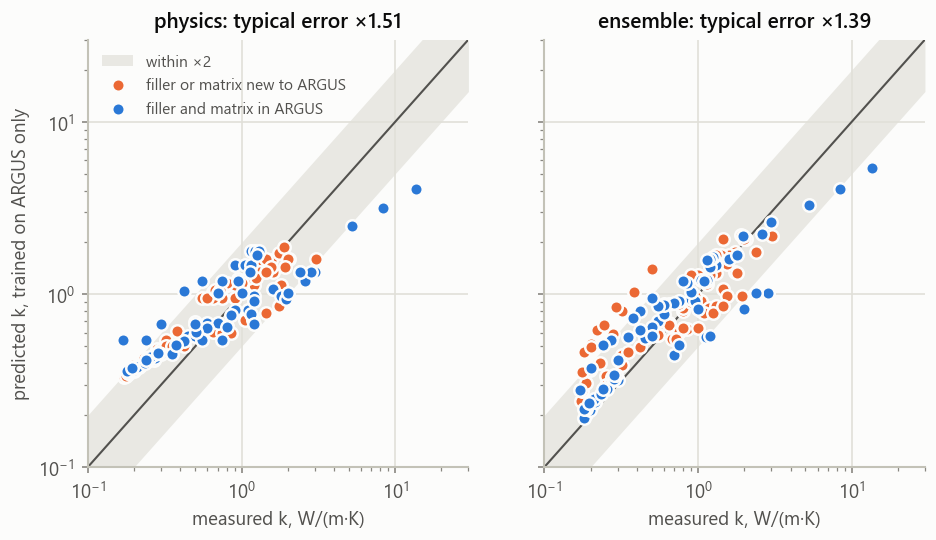
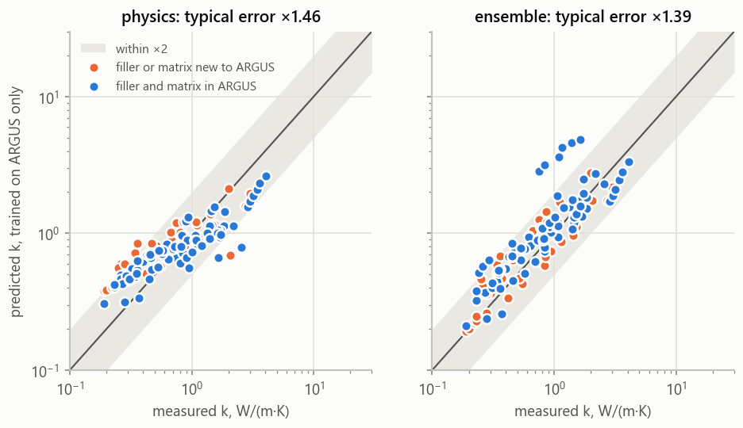
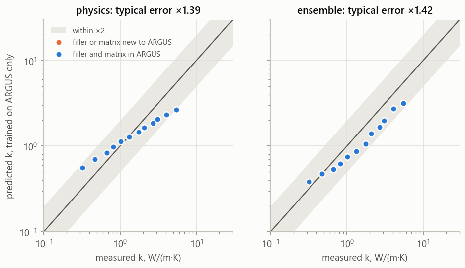

# External validation

Generated by `argus external validate` from ARGUS (258 rows, 95 papers, fingerprint `12ef8fe97057dafc`) and the external datasets in `data/external/`.

## Sources

| Source | Licence | Role | Rows (papers) loaded | Test rows (papers) after the leakage guard | Raw files |
|---|---|---|---|---|---|
| EVF_Thermal_Conductivity_Dataset (evf) | CC-BY-4.0 | test | 137 (14) | 137 (14) | ok |
| Supplementary Data 1 of He, Wu & Fu, Nat. Commun. 2025 (ncomms) | CC-BY-NC-ND-4.0 | test | 132 (20) | 125 (19) | ok |
| Digitized percolation datasets of Sarikhani et al. 2022 (S10) (tagp) | CC-BY-4.0 | test | 21 (2) | 12 (1) | ok (on-demand files not fetched) |
| Mumtaz et al. 2024, Heliyon 10, e25381, Table 1 (heliyon) | CC-BY-NC-ND-4.0 | crosscheck | 4 (2) | – | ok |
| Data Supporting "Thermal Conductivity Modeling Beyond the Dilute Limit" (bcc) | MIT | physics checks only | 242 (–) | – | ok |

**Leakage guard.** Test rows from papers that ARGUS also contains were moved to the value cross-check: ncomms: 7 rows (10.3390/polym14142950); tagp: 9 rows (10.1002/adfm.201900412).

## 1. Our physics code against two independent implementations

Both workbooks publish their own model predictions next to each point. We fed the same inputs to `argus.physics.emt` and compared.

| Workbook | Model | Points | Identical (≤1e-9) | Largest relative difference |
|---|---|---|---|---|
| evf | maxwell_garnett | 137 | 137 | 5.6e-16 |
| evf | bruggeman_symmetric | 137 | 137 | 1.6e-12 |
| evf | (parallel + series) / 2 | 137 | 137 | 4.4e-16 |
| evf | hasselman_johnson (Nan 1997, spheres) | 137 | 137 | 7.8e-16 |
| bcc | maxwell_garnett | 242 | 242 | 4.4e-16 |
| bcc | hasselman_johnson (radius = 2r/2) | 242 | 242 | 6.7e-16 |
| bcc | bruggeman_dem (r_k = 0) | 242 | 19 | 1.8 |

For the asymmetric Bruggeman model 171 of 242 BCC points agree within 1e-4. At the other 71, our root satisfies the model's defining equation to 8e-14 while the published value misses it by at least 2e-05, so the differences lie in the workbook's values, not in our code. 51 of them are below 1% (solver tolerance); the 20 larger ones include a few rows whose values appear shifted within one series.

## 2. How the interface-free models do on high-loading polymer composites (BCC)

150 BCC points with a polymer matrix (km < 1.0 W/(m·K)); 64 at 0-20 vol%, 39 at 20-40 vol%, 47 at 40-100 vol%.

| Model | MAE (log10) | Bias | 0-20 vol% | 20-40 vol% | 40-100 vol% |
|---|---|---|---|---|---|
| bruggeman_dem | 0.131 | -0.030 | 0.098 | 0.163 | 0.150 |
| lewis_nielsen_spheres | 0.166 | -0.060 | 0.109 | 0.192 | 0.224 |
| maxwell_garnett | 0.171 | -0.147 | 0.103 | 0.198 | 0.240 |
| bruggeman_symmetric | 0.458 | +0.387 | 0.094 | 0.294 | 1.090 |

81% of these points lie above the isolated-sphere ceiling km(1 + 2φ)/(1 − φ) (72% at 0-20 vol%, 80% at 20-40 vol%, 96% at 40-100 vol%), so particle contacts carry heat even at modest loading.

## 3. Trained on ARGUS, tested on papers it has never seen

Each model is fitted on all ARGUS rows and predicts the external rows. MAE is in log10 units (0.15 = typical error ×1.41); the 95% interval resamples whole test papers. 'vs physics' is the paired difference in MAE (negative = better than calibrated physics). Coverage is the share of external rows inside the model's 90% interval built from ARGUS leave-one-paper-out residuals.

### evf: 137 rows, 14 papers (69 rows with filler and matrix already in ARGUS)

| Model | MAE (95% CI) | ×factor | Bias | In ARGUS domain | New filler/matrix | vs physics (95% CI) | 90% coverage | ARGUS LOPO MAE |
|---|---|---|---|---|---|---|---|---|
| ensemble | 0.143 (0.096–0.198) | ×1.39 | +0.051 | 0.133 | 0.154 | -0.035 (-0.086–0.010) | 100% | 0.223 |
| gp_residual | 0.159 (0.130–0.196) | ×1.44 | +0.054 | 0.172 | 0.145 | -0.020 (-0.031–-0.011) **clear** | 100% | 0.240 |
| ridge | 0.160 (0.096–0.228) | ×1.45 | -0.009 | 0.151 | 0.169 | -0.018 (-0.086–0.043) | 97% | 0.238 |
| physics | 0.178 (0.148–0.217) | ×1.51 | +0.070 | 0.205 | 0.151 | reference | 100% | 0.330 |
| xgboost | 0.182 (0.114–0.265) | ×1.52 | +0.107 | 0.151 | 0.214 | +0.004 (-0.071–0.081) | 94% | 0.236 |
| knn | 0.256 (0.190–0.337) | ×1.80 | +0.156 | 0.324 | 0.186 | +0.078 (0.032–0.131) **clear** | 90% | 0.281 |
| random_forest | 0.328 (0.278–0.379) | ×2.13 | +0.258 | 0.304 | 0.353 | +0.150 (0.096–0.201) **clear** | 87% | 0.233 |
| median | 0.410 (0.343–0.505) | ×2.57 | +0.328 | 0.411 | 0.408 | +0.232 (0.176–0.302) **clear** | 98% | 0.422 |

### ncomms: 125 rows, 19 papers (82 rows with filler and matrix already in ARGUS)

| Model | MAE (95% CI) | ×factor | Bias | In ARGUS domain | New filler/matrix | vs physics (95% CI) | 90% coverage | ARGUS LOPO MAE |
|---|---|---|---|---|---|---|---|---|
| ensemble | 0.143 (0.105–0.200) | ×1.39 | +0.086 | 0.149 | 0.132 | -0.022 (-0.058–0.037) | 96% | 0.223 |
| gp_residual | 0.159 (0.125–0.199) | ×1.44 | +0.051 | 0.157 | 0.162 | -0.006 (-0.034–0.033) | 100% | 0.240 |
| physics | 0.165 (0.140–0.189) | ×1.46 | +0.036 | 0.151 | 0.191 | reference | 100% | 0.330 |
| xgboost | 0.179 (0.119–0.256) | ×1.51 | +0.041 | 0.187 | 0.166 | +0.015 (-0.046–0.092) | 95% | 0.236 |
| ridge | 0.190 (0.138–0.247) | ×1.55 | +0.167 | 0.194 | 0.182 | +0.025 (-0.025–0.078) | 100% | 0.238 |
| random_forest | 0.284 (0.237–0.331) | ×1.92 | +0.283 | 0.241 | 0.365 | +0.119 (0.080–0.160) **clear** | 90% | 0.233 |
| knn | 0.284 (0.218–0.366) | ×1.92 | +0.268 | 0.249 | 0.350 | +0.119 (0.066–0.194) **clear** | 93% | 0.281 |
| median | 0.375 (0.320–0.437) | ×2.37 | +0.303 | 0.347 | 0.427 | +0.210 (0.148–0.276) **clear** | 98% | 0.422 |

### tagp: 12 rows, 1 papers (12 rows with filler and matrix already in ARGUS)

| Model | MAE (95% CI) | ×factor | Bias | In ARGUS domain | New filler/matrix | vs physics (95% CI) | 90% coverage | ARGUS LOPO MAE |
|---|---|---|---|---|---|---|---|---|
| gp_residual | 0.103 (n/a, < 3 papers) | ×1.27 | -0.080 | 0.103 | nan | -0.041 (n/a, < 3 papers) | 100% | 0.240 |
| random_forest | 0.110 (n/a, < 3 papers) | ×1.29 | -0.066 | 0.110 | nan | -0.033 (n/a, < 3 papers) | 100% | 0.233 |
| knn | 0.140 (n/a, < 3 papers) | ×1.38 | +0.000 | 0.140 | nan | -0.004 (n/a, < 3 papers) | 100% | 0.281 |
| physics | 0.144 (n/a, < 3 papers) | ×1.39 | -0.038 | 0.144 | nan | reference | 100% | 0.330 |
| xgboost | 0.148 (n/a, < 3 papers) | ×1.41 | -0.134 | 0.148 | nan | +0.004 (n/a, < 3 papers) | 100% | 0.236 |
| ensemble | 0.151 (n/a, < 3 papers) | ×1.42 | -0.137 | 0.151 | nan | +0.007 (n/a, < 3 papers) | 100% | 0.223 |
| ridge | 0.208 (n/a, < 3 papers) | ×1.61 | -0.198 | 0.208 | nan | +0.064 (n/a, < 3 papers) | 100% | 0.238 |
| median | 0.317 (n/a, < 3 papers) | ×2.08 | -0.043 | 0.317 | nan | +0.173 (n/a, < 3 papers) | 100% | 0.422 |

### all: 274 rows, 34 papers (163 rows with filler and matrix already in ARGUS)

| Model | MAE (95% CI) | ×factor | Bias | In ARGUS domain | New filler/matrix | vs physics (95% CI) | 90% coverage | ARGUS LOPO MAE |
|---|---|---|---|---|---|---|---|---|
| ensemble | 0.144 (0.113–0.180) | ×1.39 | +0.059 | 0.142 | 0.145 | -0.027 (-0.057–0.008) | 98% | 0.223 |
| gp_residual | 0.156 (0.134–0.181) | ×1.43 | +0.047 | 0.159 | 0.152 | -0.015 (-0.028–0.003) | 100% | 0.240 |
| physics | 0.171 (0.151–0.191) | ×1.48 | +0.049 | 0.173 | 0.166 | reference | 100% | 0.330 |
| ridge | 0.176 (0.135–0.219) | ×1.50 | +0.063 | 0.177 | 0.174 | +0.005 (-0.033–0.047) | 98% | 0.238 |
| xgboost | 0.180 (0.135–0.233) | ×1.51 | +0.066 | 0.169 | 0.195 | +0.009 (-0.038–0.061) | 95% | 0.236 |
| knn | 0.264 (0.216–0.317) | ×1.83 | +0.200 | 0.273 | 0.250 | +0.093 (0.057–0.135) **clear** | 92% | 0.281 |
| random_forest | 0.298 (0.259–0.335) | ×1.99 | +0.255 | 0.258 | 0.358 | +0.128 (0.092–0.164) **clear** | 89% | 0.233 |
| median | 0.390 (0.348–0.439) | ×2.45 | +0.300 | 0.372 | 0.415 | +0.219 (0.179–0.263) **clear** | 98% | 0.422 |

## 4. Does adding the external rows to training help?

Leave-one-paper-out over ARGUS + external papers, scored separately on each side and compared, paper by paper, with training on ARGUS alone (negative = pooling helps).

### Pooled with all (492 rows, 114 papers)

| Model | ARGUS rows: alone → pooled | difference (95% CI) | External rows: transfer → pooled | difference (95% CI) |
|---|---|---|---|---|
| physics | 0.330 → 0.320 | -0.010 (-0.024–0.006) | 0.171 → 0.143 | -0.027 (-0.039–-0.017) |
| ridge | 0.238 → 0.227 | -0.011 (-0.035–0.013) | 0.176 → 0.139 | -0.037 (-0.067–-0.008) |
| gp_residual | 0.240 → 0.254 | +0.014 (-0.007–0.032) | 0.156 → 0.131 | -0.025 (-0.058–0.007) |
| xgboost | 0.236 → 0.218 | -0.018 (-0.035–-0.002) | 0.180 → 0.137 | -0.043 (-0.077–-0.013) |
| random_forest | 0.233 → 0.228 | -0.005 (-0.023–0.013) | 0.298 → 0.109 | -0.190 (-0.228–-0.149) |
| ensemble | 0.223 → 0.213 | -0.010 (-0.022–0.003) | 0.144 → 0.123 | -0.021 (-0.043–-0.001) |

## 5. Same paper, independent extraction

Papers present in both ARGUS and an external source; each external point is paired with the ARGUS point of the same filler at the closest loading (within 1 vol% or 5%) and a compatible direction.

| Source | Shared papers | Pairs | Agree (≤5%) | Minor (5–15%) | Disagree (>15%) | External points with no ARGUS partner |
|---|---|---|---|---|---|---|
| evf | 0 | 0 | 0 | 0 | 0 | 0 |
| ncomms | 1 | 0 | 0 | 0 | 0 | 7 |
| tagp | 1 | 1 | 1 | 0 | 0 | 8 |
| heliyon | 2 | 3 | 2 | 1 | 0 | 1 |

| Source | DOI | ARGUS row | Loading ARGUS / external | Direction ARGUS / external | k ARGUS | k external | Difference |
|---|---|---|---|---|---|---|---|
| tagp | 10.1002/adfm.201900412 | 518e8419-217 | 15 / 15 vol% | unknown / in-plane | 6.07 | 6.07 | +0.0% (agree) |
| heliyon | 10.1002/adfm.201900412 | 518e8419-217 | 15 / 15 vol% | unknown / in-plane | 6.07 | 6.54 | +7.7% (minor) |
| heliyon | 10.1016/j.compscitech.2020.108304 | 034b59a3-213 | 47.26 / 47.26 vol% | in-plane / in-plane | 9.48 | 9.48 | +0.0% (agree) |
| heliyon | 10.1016/j.compscitech.2020.108304 | 034b59a3-214 | 47.26 / 47.26 vol% | through-plane / through-plane | 4.45 | 4.45 | +0.0% (agree) |

**Reviewed by hand** (2026-10-25; `data/external/crosscheck_review.yaml`):

- **10.1002/adfm.201900412** (P081 (Han et al. 2019, BNNS aerogel / epoxy), one abstract-only row, 15 vol% -> 6.07 W/(m K), direction unknown). ARGUS value confirmed by an independent extraction; the review's 6.54 belongs to 20 vol%. *Action:* None now. If the full text becomes accessible, set the direction to in-plane and add the Fig. 1(d) series (two secondary sources agree on both).
- **10.1016/j.compscitech.2020.108304** (Wei et al. 2020 (AlN honeycomb / epoxy), 47.26 vol% -> 9.48 (parallel) and 4.45 (perpendicular)). ARGUS values confirmed. *Action:* None.
- **10.3390/polym14142950** (Polymers 2022 (AlN, BN and AlN-BN in epoxy), AlN/EP at 30 wt% -> 1.1 and 75 wt% -> 6.83 W/(m K)). ARGUS matches the paper's text; the compilation's top loading exceeds the paper's stated maximum. *Action:* None. Not a test row either way (the paper is in ARGUS, so the leakage guard drops it).

