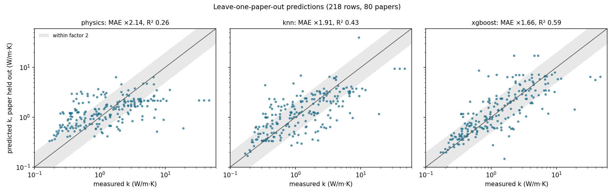

# ML benchmark: predicting k for an unseen paper

_Generated by `argus ml benchmark`. Every number below comes from models that never saw the test paper (except the row-level `random5` column, shown to expose leakage)._

## Summary

- **xgboost predicts k within a typical factor of 1.66** for a paper it has never seen (leave-one-paper-out MAE 0.221 in log10; R² 0.59; 75% of rows within a factor of 2).
- **Acceptance passes:** the best baseline (knn) reaches ×1.91 (MAE 0.281); the physics-only baseline reaches ×2.14.
- **Row-level random splits overstate accuracy.** For gp_residual, random 5-fold MAE is 0.152 vs 0.242 when papers are kept together. Published R² of 0.95–0.99 from random splits are not comparable.
- **Honest uncertainty is large.** 90% paper-grouped intervals cover 90% of rows but span ×/÷3.4 around the prediction: composition alone does not pin down k, because processing and measurement differences between papers dominate (see reports/method_bias.md).

## 1. Data

218 single-filler rows from 80 papers with a known loading; target `log10(k / k_matrix_effective)` (SD 0.488). 27 features in groups: direction, filler, loading, matrix, method, morphology, physics, quality, treatment, year. Hybrid-filler rows are excluded (no volume fraction).

## 2. Results by validation scheme

MAE in log10 units (×factor in brackets). Lower is better.

| Model | Leave-one-paper-out | R² (LOPO) | Within ×2 | 5-fold by paper | 5-fold by row (leaky) | Time split (train ≤2021) |
|---|---|---|---|---|---|---|
| **xgboost** | 0.221 (×1.66) | 0.59 | 75% | 0.233 ± 0.009 | 0.159 | 0.307 |
| **random_forest** | 0.233 (×1.71) | 0.59 | 71% | 0.241 ± 0.008 | 0.197 | 0.275 |
| **ridge** | 0.240 (×1.74) | 0.59 | 69% | 0.244 ± 0.015 | 0.204 | 0.269 |
| **gp_residual** | 0.243 (×1.75) | 0.55 | 72% | 0.242 ± 0.007 | 0.152 | 0.302 |
| **knn** (baseline) | 0.281 (×1.91) | 0.43 | 62% | 0.292 ± 0.008 | 0.262 | 0.344 |
| **physics** (baseline) | 0.330 (×2.14) | 0.26 | 51% | 0.335 ± 0.004 | 0.322 | 0.366 |
| **median** (baseline) | 0.422 (×2.64) | -0.08 | 37% | 0.423 ± 0.012 | 0.408 | 0.423 |

Models:
- `median`: Baseline: training median (no information)
- `physics`: Baseline: Nan 1997 random platelets, calibrated a + b*log enhancement
- `knn`: Baseline: 5 nearest neighbours on loading + filler type
- `ridge`: Ridge regression on all features (alpha by grouped inner CV)
- `gp_residual`: Calibrated physics + Gaussian process on residuals
- `xgboost`: Gradient boosting, constrained to be non-decreasing in loading
- `random_forest`: Random forest (500 trees, min leaf 3)

## 3. Extrapolation to an unseen filler family

Train without one family, test on it (MAE log10).

| Model | AlN held out (20 rows) | BNNS held out (53 rows) | hBN held out (137 rows) |
|---|---|---|---|
| xgboost | 0.313 | 0.228 | 0.249 |
| random_forest | 0.300 | 0.258 | 0.256 |
| ridge | 0.280 | 0.227 | 0.247 |
| gp_residual | 0.437 | 0.362 | 0.219 |
| knn | 0.389 | 0.273 | 0.273 |
| physics | 0.561 | 0.487 | 0.376 |
| median | 0.392 | 0.451 | 0.437 |

## 4. Prediction intervals (group-conformal)

For each held-out paper, the half-width is the quantile of the other papers' absolute leave-one-paper-out errors.

| Model | 68% coverage | 68% width | 90% coverage | 90% width |
|---|---|---|---|---|
| xgboost | 68% | ×/÷1.85 | 90% | ×/÷3.35 |
| random_forest | 69% | ×/÷1.97 | 90% | ×/÷3.14 |
| ridge | 68% | ×/÷1.96 | 90% | ×/÷3.16 |
| gp_residual | 69% | ×/÷1.95 | 90% | ×/÷3.68 |
| knn | 69% | ×/÷2.24 | 90% | ×/÷4.20 |
| physics | 69% | ×/÷2.53 | 90% | ×/÷4.30 |
| median | 68% | ×/÷3.49 | 90% | ×/÷5.88 |

## 5. Which information helps? (ablation, xgboost, group5 x5 (paired splits))

MAE with all features: 0.233. Δ = MAE without the group minus MAE with it, averaged over 5 paper-grouped 5-fold repeats that use the same splits (paired). Positive Δ = the group helps predict unseen papers.

| Feature group removed | MAE | Δ (mean ± SD over repeats) | Clearly helps (Δ > 2 SD) |
|---|---|---|---|
| loading + physics | 0.363 | +0.130 ± 0.028 | yes |
| direction + method | 0.278 | +0.044 ± 0.011 | yes |
| direction | 0.265 | +0.032 ± 0.009 | yes |
| morphology | 0.242 | +0.009 ± 0.005 |  |
| year | 0.241 | +0.007 ± 0.008 |  |
| quality | 0.237 | +0.004 ± 0.004 |  |
| physics | 0.237 | +0.003 ± 0.004 |  |
| filler | 0.236 | +0.002 ± 0.003 |  |
| method | 0.235 | +0.002 ± 0.005 |  |
| loading | 0.233 | -0.000 ± 0.002 |  |
| treatment | 0.229 | -0.004 ± 0.003 |  |
| matrix | 0.225 | -0.008 ± 0.011 |  |

Clearly helpful: loading + physics, direction + method, direction. Others are not distinguishable from zero with this data.
Rows with '+' remove two groups that overlap (the physics feature is computed from loading; the method implies a default direction), so a group can look unimportant alone while the pair matters.

## 6. Parity plot

## Caveats

- 80 papers is small: differences between learned models of a few 0.01 log10 are within noise (see the ± column).
- Loading is partly converted from wt% and k_m is partly a family default (`*_basis` columns); both add error that no model can remove.
- The time split is harder than leave-one-paper-out. Papers from 2022 on differ from older ones: BNNS 34% vs 20% of rows, aligned fillers 20% vs 9%, and a lower median enhancement (0.64 vs 0.86 log10). A model trained on older papers meets a shifted population. On this split the best model is ridge (MAE 0.269).
- Intervals are calibrated on average over papers, not for every paper.
